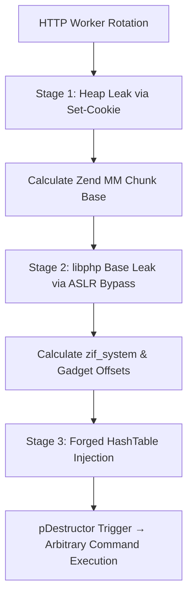

# PHP2Shell: Advanced PHP Session & Upload-Progress Exploit Lab

> **Security Research & Educational Laboratory by Agit ([@agtt](https://github.com/agtt))**  
> In-depth analysis, heap layout exploitation, and reproducible testbed for PHP 8.4.26 session state vulnerabilities (CVE-2026-109618 / CVE-2026-109619).

---

## Overview

This repository provides an end-to-end educational environment and technical analysis detailing remote code execution against PHP 8.4.26 running under Apache prefork with `mod_php`.

The exploit chain takes advantage of interactions between PHP's multipart `upload_progress` feature, stale global session pointers (`ps_globals`), and the Zend Memory Manager (Zend MM). It achieves full RCE over pure HTTP without requiring any vulnerable application logic on the server.

### Key Highlights

- **Zero Target Code Dependency**: The target script (`docker/www/index.php`) does not invoke `session_start()` or handle user inputs. It simply serves a static greeting:
  ```text
  agtt-lab :: target online
  ```
  The vulnerability executes during request initialization before application script execution.
- **Two-Stage Pure HTTP ASLR Bypass**: Discloses both the Zend MM chunk base and the `libphp` module base purely via crafted `Set-Cookie` header lengths and responses.
- **Controlled Execution Flow**: Synthesizes a forged `HashTable` inside reclaimed heap memory, redirecting array destruction pointers to `zif_system`.
- **Reproducible Lab**: Includes a local Docker Compose testbed matching the exact memory layout of official Debian-based Apache images.

---

## Vulnerability Mechanics & Attack Chain



1. **Pre-RINIT Entry Point (`upload_progress`)**:
   When `session.upload_progress.enabled = 1`, incoming multipart requests containing `PHP_SESSION_UPLOAD_PROGRESS` trigger `php_session_initialize()` before PHP runs the requested script.
2. **Stale Global State (`ps_globals.id`)**:
   An intentionally exhausted worker triggers a bailout during cookie handling. Because cleanup paths fail to reset `ps_globals.send_cookie` and `ps_globals.id`, a dangling pointer to freed heap memory survives into the subsequent request.
3. **Heap Disclosure (Zend MM Chunk Base)**:
   A tailored multipart payload reclaims the stale pointer block with a forged string header. The server emits an oversized `Set-Cookie` header containing leaked heap addresses.
4. **Library Disclosure (`libphp` Base)**:
   A second leak extracts function pointers (`zval_ptr_dtor`), defeating full ASLR without requiring local process inspection or `/proc` reads.
5. **Control-Flow Hijack**:
   The exploit places a crafted PHP array structure into the reclaimed chunk. When PHP cleans up the fake array upon request completion, its destructor (`pDestructor`) dispatches directly into `zif_system()`, executing the attacker-specified command.

---

## Quickstart: Local Lab Environment

### Prerequisites
- Docker & Docker Compose
- Python 3.9+

### 1. Launch the Lab

Start the isolated single-worker container:

```bash
docker compose -f docker/docker-compose.yml up -d
```

Verify that the target endpoint is active:

```bash
curl -i http://127.0.0.1:8088/index.php
# HTTP/1.1 200 OK
# Content-Type: text/html; charset=UTF-8
# agtt-lab :: target online
```

### 2. Execute the Reproduction Exploit

Run the automated one-shot exploit:

```bash
python3 exploit.py -u http://127.0.0.1:8088/index.php
```

To run a custom command and capture proof:

```bash
python3 exploit.py -u http://127.0.0.1:8088/index.php -c 'id>/out/p1' --proof-file out/p1
```

Expected output:
```text
============================================================
  PHP2Shell Exploit Environment [by Agit / @agtt]
  Target: PHP 8.4.26 (prefork / mod_php)
============================================================

[*] target http://127.0.0.1:8088/index.php (cmd='id>/out/p1')
[*] stage 1: heap leak (attempt 1/15)
[+] chunk: 0x7f...
[*] stage 2: libphp leak
[+] libphp: 0x7f...
[*] stage 3: HTDATA=0x... ZIF=0x...
[+] W3 attempt 1
PROOF: uid=33(www-data) gid=33(www-data) groups=33(www-data)
```

### 3. Teardown

```bash
docker compose -f docker/docker-compose.yml down
```

---

## Safe Version Verification

To audit PHP installations locally or via harmless HTTP headers without running any exploit payloads, use [`check.php`](check.php):

```bash
# Check local CLI PHP
php check.php

# Check remote server via harmless version header inspection
php check.php --url https://example.com/
```

Detailed guide and exit code reference: [VERSION_CHECK.md](VERSION_CHECK.md).

---

## Research Documentation Index

| Research Document | Summary |
| :--- | :--- |
| [REPRODUCTION.md](REPRODUCTION.md) | Full step-by-step reproduction sequence and verified environments |
| [NOTES.md](NOTES.md) | Engine source analysis and root cause breakdown |
| [HTTP_HEAP_LEAK.md](HTTP_HEAP_LEAK.md) | Multipart allocation dynamics and Set-Cookie heap disclosure |
| [ASLR_PURE_HTTP.md](ASLR_PURE_HTTP.md) | Complete ASLR bypass via remote HTTP reads |
| [DISPLAY_ERRORS_OFF.md](DISPLAY_ERRORS_OFF.md) | Silent OOM exploitation without error output (`display_errors=0`) |
| [NOASLR_REPORT.md](NOASLR_REPORT.md) | Baseline mechanics and proof-of-concept under fixed addresses |
| [NOTES_BG.md](NOTES_BG.md) | Alternative pre-RINIT `BG(unserialize)` investigation |
| [logs/](logs/) | GDB traces, memory maps, and technical execution logs |
| [tools/](tools/) | Low-level calibration probes, heap scanners, and GDB automation |

---

## Upstream Advisories & Remediation

Upstream PHP addressed these vulnerabilities across all active branches:
- **CVE-2026-109618**: [GHSA-w8hw-w9fx-j79w](https://github.com/php/php-src/security/advisories/GHSA-w8hw-w9fx-j79w)
- **CVE-2026-109619**: [GHSA-6wmf-4rv5-p3rp](https://github.com/php/php-src/security/advisories/GHSA-6wmf-4rv5-p3rp)

Patched releases: **8.2.35**, **8.3.36**, **8.4.27**, and **8.5.12**.

---

## Disclaimer

This project is created strictly for educational purposes, defensive security auditing, and vulnerability research. Do not execute exploit scripts against targets without explicit, documented authorization.
